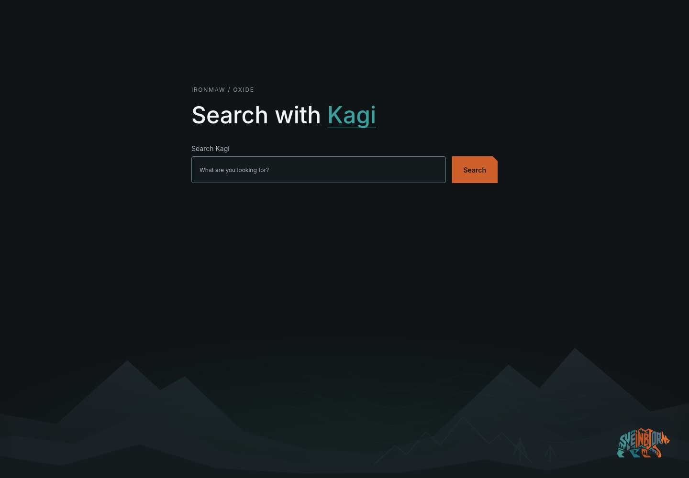

# IRONMAW New Tab for Kagi

The IRONMAW landscape with a search box that opens Kagi instead of Google.
This is a small, separate Manifest V3 extension: plain HTML/CSS, no JavaScript,
requested permissions, remote resources, tracking, or stored credentials. A
search submits a normal HTTPS GET request to `https://kagi.com/search?q=…`.

## Install from this checkout

The generated files are committed, so you do not need to run a script.

1. Sign in to [Kagi](https://kagi.com/) in the browser profile you will use.
2. Open `chrome://extensions` and enable **Developer mode**.
3. Choose **Load unpacked** and select this repository's `chrome-new-tab/` folder.
4. Also load `chrome-theme/` for the matching native tab and toolbar colors.
5. Open a new tab. If Chrome asks about the new-tab change, choose **Keep it**.
6. To use this page when Chrome starts, open `chrome://settings/onStartup` and
   select **Open the New Tab page**.

Remove or disable **IRONMAW New Tab for Kagi** at `chrome://extensions` to return
to Chrome's native page. The theme remains independently installed. This page
replaces Chrome's native search box, shortcut tiles and Customize Chrome controls;
it does not read or modify your bookmarks or history. Chrome does not allow
new-tab overrides in incognito windows.

## Address-bar searches

This page sends searches directly to Kagi. It does not change the browser's
address-bar search provider. To use Kagi there too, follow
[Kagi's official Chrome setup](https://help.kagi.com/kagi/getting-started/setting-default/chromium-desktop.html):
install the [official Kagi extension](https://github.com/kagisearch/chrome_extension_basic),
or add `https://kagi.com/search?q=%s` at `chrome://settings/searchEngines` and
choose **Make default**. No API key or private session token is needed here.

## Regenerate and package

From the repository root, `pnpm run chrome-theme` regenerates the artwork and
tokens for both distributions. `pnpm run chrome-theme:pack` also creates:

| Archive | Install |
| --- | --- |
| `chrome-theme-dist/ironmaw-oxide-chrome.zip` | Native browser theme |
| `chrome-theme-dist/ironmaw-kagi-new-tab.zip` | Kagi new-tab companion |

Extract each ZIP into its own folder, then use **Load unpacked** on those folders.
After rebuilding, reload the companion at `chrome://extensions` and reopen the tab.
The companion archive contains only its manifest, HTML, two CSS files, and five
referenced PNGs. The README and preview are not shipped inside it. Builds preserve
the authored HTML, stylesheet and manifest; only generated tokens and images are
published. Neither distribution enters the npm library package.

Both distributions are staged under the existing theme build lock. A render or
ZIP failure preserves the previous generated outputs and archives. Publication
uses per-file renames, so a filesystem failure or power loss during publication
can still leave a partial generation; rerun the build after recovery.

## Validation and limits

Loaded as an unpacked extension in Chromium 156.0.8078.79 on Linux. The page was
checked at 1440 x 1000, 800 x 600 and 360 x 480: no overflow, loaded artwork, and
no overlap between the search field and bear. An Enter-key submission with
spaces, punctuation and Icelandic text produced the expected Kagi GET URL. That
request was intercepted before reaching Kagi; authenticated search results,
login redirects and account billing were not tested. Unit tests cover the form,
resource inventory, lack of scripts/permissions, and shared generated assets.

This companion is for local unpacked installation. It is not a Chrome Web Store
submission: the direct Kagi form would need adapting to the
[store's requirement to use Chrome's search API and respect the active provider](https://developer.chrome.com/docs/webstore/troubleshooting#single-purpose).
Google Chrome itself, other operating systems and HiDPI were not tested. No
personal browser profile was modified. This is not an official Kagi product.
