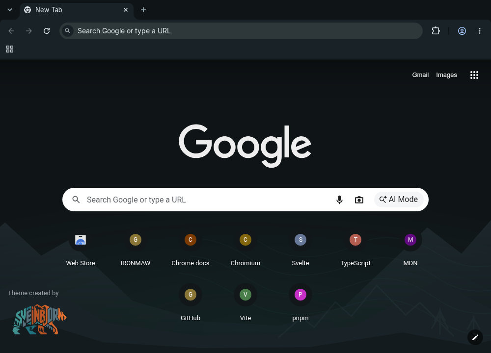

# IRONMAW Oxide for Chrome

Charcoal browser surfaces, readable mist text, teal links, and layered slate
ridges under a quiet teal horizon. The original bear signs the lower-left
corner through Chrome's native theme attribution. The browser keeps
its normal search and shortcuts. This is a Manifest V3 theme: no scripts,
permissions, tracking, or network resources.


The visual direction takes inspiration from
[the-glorious-startpage](https://github.com/manilarome/the-glorious-startpage):
broad scenery, depth between surfaces, and a clear area for the primary task.
This theme uses original vector composition and IRONMAW assets and tokens;
no artwork or code from the reference is bundled. Chrome retains search,
shortcuts and its own controls.

<details>
<summary>Compact window with ten native shortcuts (1000 x 720)</summary>



</details>

## Install and remove

1. Download or clone this repository. The committed `chrome-theme/` directory
   is ready to load; building is optional.
2. Open `chrome://extensions` in Google Chrome and enable **Developer mode**.
3. Choose **Load unpacked** and select this `chrome-theme` directory (the one
   containing `manifest.json`). Open a new tab to see the artwork.
4. To remove it, open Chrome **Settings > Appearance > Theme > Reset to default**.

Installing replaces the selected browser theme. If you already have a custom
new-tab background, reset that background in **Customize Chrome** to see this
theme's image. Browser policy may prevent loading unpacked themes.

## Regenerate and package

Use Node `^22.18.0 || >=24.0.0` and the pinned pnpm version. Asset generation
also requires `rsvg-convert` (Arch: `librsvg`); ZIP packaging requires `zip`. No new npm
dependencies are needed.

From the repository root:

```bash
pnpm install --frozen-lockfile
pnpm run chrome-theme
pnpm exec vitest run scripts/chrome-theme*.test.mjs src/lib/tokens/palette.test.ts
pnpm run chrome-theme:pack
unzip -l chrome-theme-dist/ironmaw-oxide-chrome.zip
```

The ZIP has `manifest.json` at its root and only referenced PNG images. Extract
it before using **Load unpacked**. The ZIP is also suitable as the theme upload
payload; Chrome Web Store publication is a separate step.

Edit `scripts/theme-colors.mjs` for mappings, `scripts/build-chrome-theme.mjs`
for composition, and the DTCG source tokens for palette changes. The build runs
the complete token pipeline, including egui, and refreshes the generated brand
modules. It reuses the cleaned full bear for attribution and package icons.
`assets/brand/terrain.svg` is the shared source for Panel and the theme; paths
and bear colors are preserved. Commit regenerated outputs alongside source
changes. Bump the manifest version in the generator
for a released update.

All colors and terrain markers are validated before rendering. Assets and the
manifest are staged under `chrome-theme/.build-lock/` before publication; a
concurrent theme build fails instead of interleaving writes. Packaging reads
only the staged manifest references, so stale or extra PNGs never enter the ZIP.
Each published file is replaced by rename, with the manifest last. This is not
a power-loss-atomic transaction across the entire file set. If a build is killed
and leaves `.build-lock/`, confirm no theme build is running before removing
that directory and rebuilding. Renderer and ZIP failures clean it automatically.
The commands avoid shell globs and Unix directory commands; Windows still needs
`rsvg-convert` and Info-ZIP `zip` on PATH and has not been exercised here.

The background is 1920 x 1080, centered horizontally, bottom-aligned, and never
tiled. Its upper 740 pixels and outer edges are plain charcoal; the lower
landscape fades into that background on larger windows. Smaller windows crop
the scenery, while the separate 128 x 96 bear attribution stays anchored by
Chrome. The toolbar uses `surface-2` and the omnibox requests `surface-1` to
separate browser surfaces. Chrome determines its own focus rings, shortcut tiles, and
some incognito colors; a theme cannot apply the full Svelte design system or
custom fonts to browser UI.

## Validation

Version 1.1.0 was loaded from the extracted ZIP in Chromium 156.0.8078.79 on
Linux/Xvfb. The 1440 x 1000 and 1000 x 720 windows were checked with the
bookmarks bar and ten native shortcuts, after dismissing Chrome's installation
notice: the bear stays clear of both shortcut rows. At 800 x 600, Chrome scrolls
the shortcut area and its fixed attribution
can overlap the first row; use at least the tested 1000 x 720 size for this
layout. Browser notices that reduce the available page height can also cause
overlap. The previews are browser captures, not mockups. Their sample shortcuts
were added only to the disposable test profile and are not installed by the theme.

The 1.0.0 browser pass also checked incognito, which retained Chromium's
default gray appearance without the themed background. Incognito was not
retested for 1.1.0.

The theme and existing palette checks cover RGB values, semantic mappings,
asset paths and PNG dimensions, and text contrast. A pixel check of the 1.1.0
background also found minimum contrast of 10.89:1 for text, 5.67:1 for headers
and 4.62:1 for teal links across the complete landscape. This pixel check was
run separately with Pillow; it is not part of the Vitest suite. The ZIP inventory
is checked separately. Google Chrome itself, Windows/macOS, HiDPI, and Chrome Web Store
installation have not been tested. Xvfb did not establish native window-manager
inactive-frame behavior. No personal browser profile was modified.

Never commit `.pem` signing keys or `.crx` files. This build uses an unsigned ZIP
and does not generate keys. Build archives stay in ignored
`chrome-theme-dist/`, separate from the npm package's `dist/` directory.

## References

- The supplied [GoogleChromeThemeCreationGuide](https://github.com/Patrick-Batenburg/GoogleChromeThemeCreationGuide)
  informed image placement, colors, and packaging.
- [Chrome's theme documentation](https://developer.chrome.com/docs/extensions/develop/ui/themes)
  supplies the current Manifest V3 example and PNG requirement, superseding the
  supplied guide's Manifest V2 and older image-format advice.
- [Chromium's supported theme keys](https://source.chromium.org/chromium/chromium/src/+/main:chrome/browser/themes/browser_theme_pack.cc)
  define the color and image fields used here; obsolete guide entries are omitted.
