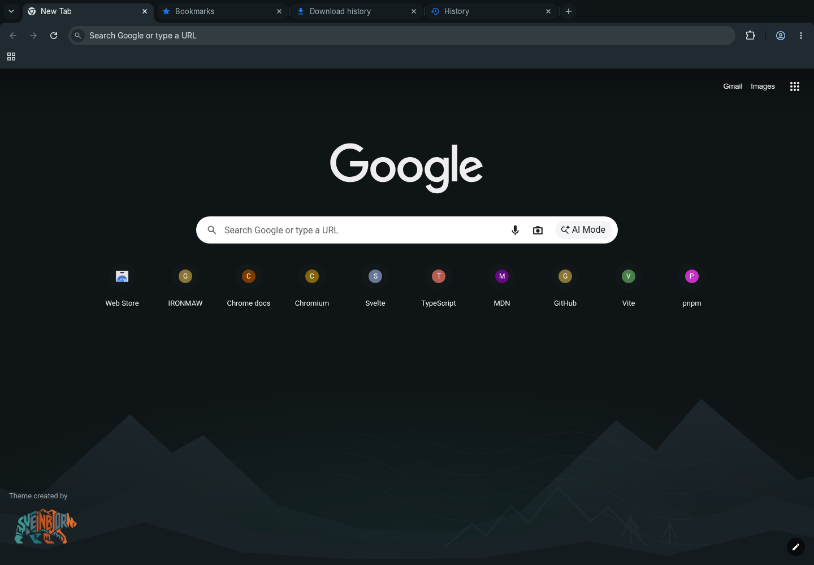

# IRONMAW Oxide for Chrome

Charcoal browser surfaces, readable mist text, teal links, and the original
bear over quiet terrain at the bottom of the new-tab page. The browser keeps
its normal search and shortcuts. This is a Manifest V3 theme: no scripts,
permissions, tracking, or network resources.



## Install and remove

1. Download or clone this repository. The committed `chrome-theme/` directory
   is ready to load; building is optional.
2. Open `chrome://extensions` in Google Chrome and enable **Developer mode**.
3. Choose **Load unpacked** and select this `chrome-theme` directory (the one
   containing `manifest.json`). Open a new tab to see the artwork.
4. To remove it, open Chrome **Settings > Appearance > Theme > Reset to default**.

Installing replaces the selected browser theme. If you already have a custom
new-tab background, reset that background in **Customize Chrome** to see this
theme's image. Browser policy may prevent loading unpacked themes.

## Regenerate and package

Use Node `^22.18.0 || >=24.0.0` and the pinned pnpm version. Asset generation
also requires `rsvg-convert` (Arch: `librsvg`); ZIP packaging requires `zip`. No new npm
dependencies are needed.

From the repository root:

```bash
pnpm install --frozen-lockfile
pnpm run chrome-theme
pnpm exec vitest run scripts/chrome-theme*.test.mjs src/lib/tokens/palette.test.ts
pnpm run chrome-theme:pack
unzip -l chrome-theme-dist/ironmaw-oxide-chrome.zip
```

The ZIP has `manifest.json` at its root and only referenced PNG images. Extract
it before using **Load unpacked**. The ZIP is also suitable as the theme upload
payload; Chrome Web Store publication is a separate step.

Edit `scripts/theme-colors.mjs` for mappings, `scripts/build-chrome-theme.mjs`
for composition, and the DTCG source tokens for palette changes. The build runs
the complete token pipeline, including egui, and refreshes the generated brand
modules. It reuses the cleaned full bear for both artwork and package icons.
`assets/brand/terrain.svg` is the shared source for Panel and the theme; paths
and bear colors are preserved. Commit regenerated outputs alongside source
changes. Bump the manifest version in the generator
for a released update.

All colors and terrain markers are validated before rendering. Assets and the
manifest are staged under `chrome-theme/.build-lock/` before publication; a
concurrent theme build fails instead of interleaving writes. Packaging reads
only the staged manifest references, so stale or extra PNGs never enter the ZIP.
Each published file is replaced by rename, with the manifest last. This is not
a power-loss-atomic transaction across the entire file set. If a build is killed
and leaves `.build-lock/`, confirm no theme build is running before removing
that directory and rebuilding. Renderer and ZIP failures clean it automatically.
The commands avoid shell globs and Unix directory commands; Windows still needs
`rsvg-convert` and Info-ZIP `zip` on PATH and has not been exercised here.

The background is 1920 x 1080, centered horizontally, bottom-aligned, and never
tiled. Its charcoal edges blend into the new-tab background on larger windows;
smaller windows crop the decoration. Very short windows can place browser-owned
content over it. Chrome determines its own focus rings, shortcut tiles, and
some incognito colors; a theme cannot apply the full Svelte design system or
custom fonts to browser UI.

## Validation

Observed on Chromium 156.0.8078.79 on Linux/Xvfb: unpacked theme loading,
1440 x 1000 and 1000 x 720 windows, active/inactive tabs,
toolbar icons, omnibox, bookmarks, and the new-tab artwork. Incognito retained
Chromium's default gray appearance and did not show the themed background.
The preview above is a browser capture, not a mockup.

The theme and existing palette checks cover RGB values, semantic mappings,
asset paths and PNG dimensions, and text contrast. The ZIP inventory is checked
separately. Google Chrome itself, Windows/macOS, HiDPI, and Chrome Web Store
installation have not been tested. Xvfb did not establish native window-manager
inactive-frame behavior. No personal browser profile was modified.

Never commit `.pem` signing keys or `.crx` files. This build uses an unsigned ZIP
and does not generate keys. Build archives stay in ignored
`chrome-theme-dist/`, separate from the npm package's `dist/` directory.

## References

- The supplied [GoogleChromeThemeCreationGuide](https://github.com/Patrick-Batenburg/GoogleChromeThemeCreationGuide)
  informed image placement, colors, and packaging.
- [Chrome's theme documentation](https://developer.chrome.com/docs/extensions/develop/ui/themes)
  supplies the current Manifest V3 example and PNG requirement, superseding the
  supplied guide's Manifest V2 and older image-format advice.
- [Chromium's supported theme keys](https://source.chromium.org/chromium/chromium/src/+/main:chrome/browser/themes/browser_theme_pack.cc)
  define the color and image fields used here; obsolete guide entries are omitted.
