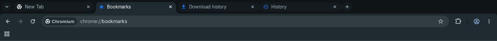
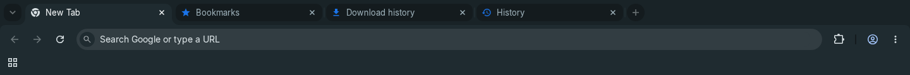

# IRONMAW Oxide for Chrome

Charcoal browser surfaces, readable mist text, teal links, and layered slate
ridges under a quiet teal horizon. The original bear signs the lower-left
corner through Chrome's native theme attribution. The browser keeps
its normal search and shortcuts. This is a Manifest V3 theme: no scripts,
permissions, tracking, or network resources.


The visual direction takes inspiration from
[the-glorious-startpage](https://github.com/manilarome/the-glorious-startpage):
broad scenery, depth between surfaces, and a clear area for the primary task.
This theme uses original vector composition and IRONMAW assets and tokens;
no artwork or code from the reference is bundled. Chrome retains search,
shortcuts and its own controls.

<details>
<summary>Compact window with ten native shortcuts (1000 x 720)</summary>


</details>

## Native tabs

The tab treatment takes its light-on-dark hierarchy from
[chrome-tabs](https://github.com/adamschwartz/chrome-tabs), an HTML/CSS/JavaScript
tab component. A Chrome theme can supply native tab colors and background
images, but cannot load that component into the browser's tab strip. Chrome
retains tab geometry, spacing, fonts, close buttons, hover effects and dragging.



The unselected tabs remain distinct when another window has focus:



| Surface or text | Theme key | Oxide value |
| --- | --- | --- |
| Focused window frame | `frame` | `bg` / `#0F1416` |
| Selected tab and toolbar | `toolbar` | `surface-3` / `#1F2B30` |
| Selected tab label | `tab_text` | `text-strong` / `#F3F6F7` |
| Unselected tabs | `background_tab` | `surface-1` / `#141B1E` |
| Unselected tab labels | `tab_background_text` | `text-muted` / `#9EB1BA` |
| Unfocused frame | `frame_inactive` | `surface-2` / `#192327` |
| Unfocused unselected tabs | `background_tab_inactive` | `surface-1` / `#141B1E` |

The selected tab shares the toolbar background in
[Chromium's native color mapping](https://chromium.googlesource.com/chromium/src/+/refs/heads/main/chrome/browser/ui/color/tab_strip_color_mixer.cc).
The selected/unselected label pairs measure 13.37:1 and 7.84:1 respectively.
Window-focus and incognito handling remain browser-controlled.

## Install and remove

1. Download or clone this repository. The committed `chrome-theme/` directory
   is ready to load; building is optional.
2. Open `chrome://extensions` in Google Chrome and enable **Developer mode**.
3. Choose **Load unpacked** and select this `chrome-theme` directory (the one
   containing `manifest.json`). Open a new tab to see the artwork.
4. To remove it, open Chrome **Settings > Appearance > Theme > Reset to default**.

Installing replaces the selected browser theme. If you already have a custom
new-tab background, reset that background in **Customize Chrome** to see this
theme's image. Browser policy may prevent loading unpacked themes.

## Regenerate and package

Use Node `^22.18.0 || >=24.0.0` and the pinned pnpm version. Asset generation
also requires `rsvg-convert` (Arch: `librsvg`); ZIP packaging requires `zip`. No new npm
dependencies are needed.

`pnpm run tokens` updates only web/native tokens; it never touches theme files
or takes the theme lock. Run `pnpm run chrome-theme` after palette or artwork
changes to regenerate the complete theme. The strict manifest/token tests fail
when mapped colors are out of sync. The former `--manifest-only` mode was removed
because it could publish new colors beside old PNGs. Neither ordinary library
builds nor token generation need librsvg or ZIP.

From the repository root:

```bash
pnpm install --frozen-lockfile
pnpm run chrome-theme
pnpm exec vitest run scripts/chrome-theme src/lib/tokens/palette.test.ts
pnpm run chrome-theme:pack
unzip -l chrome-theme-dist/ironmaw-oxide-chrome.zip
```

The ZIP has `manifest.json` at its root and only referenced PNG images. Extract
it before using **Load unpacked**. The ZIP is also suitable as the theme upload
payload; Chrome Web Store publication is a separate step.

Edit `scripts/theme-colors.mjs` for mappings, `scripts/build-chrome-theme.mjs`
for composition, and the DTCG source tokens for palette changes. The build runs
the complete token pipeline, including egui, and refreshes the generated brand
modules. It reuses the cleaned full bear for attribution and package icons.
`assets/brand/terrain.svg` is the shared source for Panel, EmptyState and the
theme. The asset builder also generates `src/lib/assets/Terrain.svelte`, so
Panel and EmptyState render compiled SVG without raw HTML insertion. EmptyState
fits a mirrored copy onto each edge, keeping the pines visible at typical sizes.
The shared component paints strokes with `--wm-terrain-structure` and
`--wm-terrain-accent` (defaulting to the palette's structure/accent tokens).
Set these inherited variables in consumer CSS, including `wm.user`; generic
`color` resets no longer recolor the artwork. No inline style permission or
Trusted Types default policy is needed; Svelte's `svelte-trusted-html` policy must
be allowed when a `trusted-types` policy allowlist is used. Bear colors are
preserved; attribution height and icon centering derive from its intrinsic ratio.
Commit regenerated outputs alongside source changes. Theme releases are versioned
independently of the npm library: bump `THEME_VERSION` in the generator before
releasing changed colors or artwork. Rebuilding alone does not bump the version.

All colors and terrain markers are validated before rendering. Assets and the
manifest are staged under `chrome-theme/.build-lock/` before publication; a
concurrent theme build fails instead of interleaving writes. Packaging reads
only the staged manifest references, so stale or extra PNGs never enter the ZIP.
After successful rendering and optional packaging, publication creates the
images directory if necessary and removes unreferenced PNG files. Other files
are left alone; failed renders and cancelled builds leave existing PNGs intact.
Each published file is replaced by rename, with the manifest last. This is not
a power-loss-atomic transaction across the entire file set. SIGINT (Ctrl+C), SIGHUP and
SIGTERM stop the active rendering/ZIP tool before removing the lock; renderer and
ZIP failures also clean it automatically. An uncatchable kill or power loss can
still leave `.build-lock/`: confirm no theme build is running before removing
that directory and rebuilding.
Cancellation is checked again before publication, including when a tool has
already exited but its output pipe has not yet closed.
The commands avoid shell globs and Unix directory commands; Windows still needs
`rsvg-convert` and Info-ZIP `zip` on PATH and has not been exercised here.

The background is 1920 x 1080, centered horizontally, bottom-aligned, and never
tiled. Its upper 740 pixels and outer edges are plain charcoal; the lower
landscape fades into that background on larger windows. Smaller windows crop
the scenery, while the separate 128 x 96 bear attribution stays anchored by
Chrome. The toolbar uses `surface-3` and the omnibox requests `surface-1` to
separate browser surfaces. Chrome determines its own focus rings, shortcut tiles, and
some incognito colors; a theme cannot apply the full Svelte design system or
custom fonts to browser UI.

## Validation

Version 1.2.1 was loaded from the extracted ZIP in Chromium 156.0.8078.79 on
Linux/Xvfb with the twm window manager. Moving focus to a second window changed
the first frame to `#192327`, while its unselected tabs stayed `#141B1E` and the
selected tab stayed `#1F2B30`. The unfocused preview is from this check; the other
previews show 1.2.0, whose focused colors and artwork are unchanged.

Version 1.2.0 was loaded in the same Chromium version on
Linux/Xvfb with four native tabs open. Switching the selected tab moved the
lighter surface correctly; screenshot samples matched the selected tab,
unselected tab and frame colors in the table above.
The 1440 x 1000 and 1000 x 720 windows were checked with the
bookmarks bar and ten native shortcuts, after dismissing Chrome's installation
notice: the bear stays clear of both shortcut rows. At 800 x 600, Chrome scrolls
the shortcut area and its fixed attribution
can overlap the first row; use at least the tested 1000 x 720 size for this
layout. Browser notices that reduce the available page height can also cause
overlap. The previews are browser captures, not mockups. Their sample shortcuts
were added only to the disposable test profile and are not installed by the theme.

The 1.0.0 browser pass also checked incognito, which retained Chromium's
default gray appearance without the themed background. Incognito was not
retested for 1.2.1.

The theme and existing palette checks cover RGB values, semantic mappings,
asset paths and PNG dimensions, text contrast, and distinct frame/tab colors in
all four mapped window states. The isolated build tests use stub `rsvg-convert`
and `zip` executables to exercise failures, concurrent-build rejection and
SIGINT/SIGTERM/SIGHUP cleanup; those fixtures are skipped on Windows. Real librsvg
rendering and Info-ZIP packaging were also run separately on Linux, including
Node 22.18.0. All six ZIP entries passed CRC checks and matched the generated
files byte for byte; an npm dry run excluded theme and ZIP artifacts.

The PR #11 review pass checked client-mounted Panel and EmptyState in Chromium
with `style-src 'self'` and Trusted Types enforcement, without a default policy.
Both mount without CSP violations, retain their default inks under broad color
resets, and inherit custom terrain inks from `wm.user`. At 800 x 280, EmptyState
shows pines at both edges; the previous single cropped vector hid them entirely.
These checks cover the components in an isolated browser page, not a synced
design project. The build tests also exercise the ZIP-exit interruption using a
signal handshake, packaging retries, and token generation with a leftover theme
lock and missing/conflicted generated brand modules.
The 78 focused tests passed; all 25 build/preflight tests also passed on Node
22.18.0. Svelte check and the library/React-adapter build passed. The packed
library installed with npm `--engine-strict` and imported its token exports on
Node 22.12.0 and 23.6.0; this is not a full consuming-application test.

A pixel check of the 1.1.0
background also found minimum contrast of 10.89:1 for text, 5.67:1 for headers
and 4.62:1 for teal links across the complete landscape. This pixel check was
run separately with Pillow; it is not part of the Vitest suite. The ZIP inventory
is checked separately. Google Chrome itself, Windows/macOS, HiDPI, and Chrome Web Store
installation have not been tested. No personal browser profile was modified.

Never commit `.pem` signing keys or `.crx` files. This build uses an unsigned ZIP
and does not generate keys. Build archives stay in ignored
`chrome-theme-dist/`, separate from the npm package's `dist/` directory.

## References

- The supplied [GoogleChromeThemeCreationGuide](https://github.com/Patrick-Batenburg/GoogleChromeThemeCreationGuide)
  informed image placement, colors, and packaging.
- [Chrome's theme documentation](https://developer.chrome.com/docs/extensions/develop/ui/themes)
  supplies the current Manifest V3 example and PNG requirement, superseding the
  supplied guide's Manifest V2 and older image-format advice.
- [Chromium's supported theme keys](https://source.chromium.org/chromium/chromium/src/+/main:chrome/browser/themes/browser_theme_pack.cc)
  define the color and image fields used here; obsolete guide entries are omitted.
