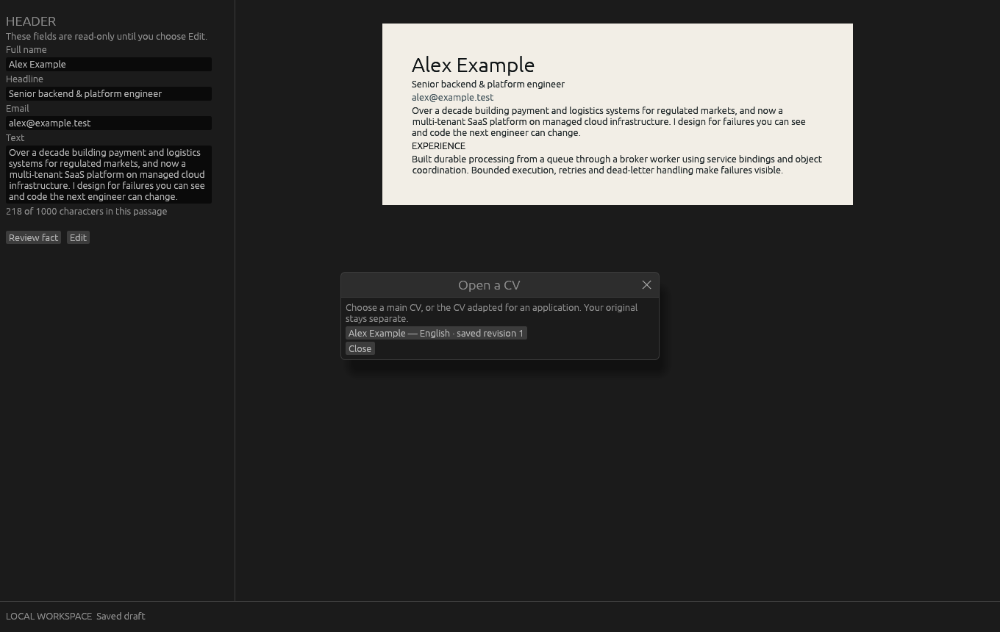
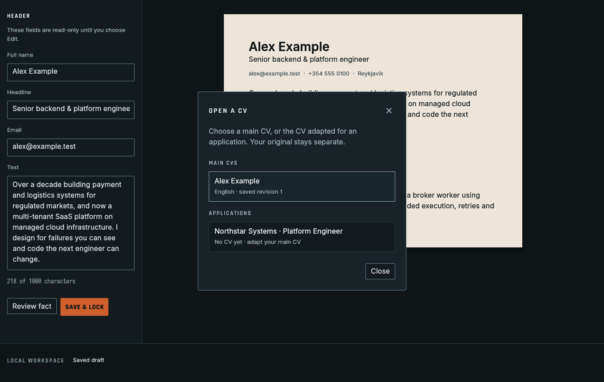
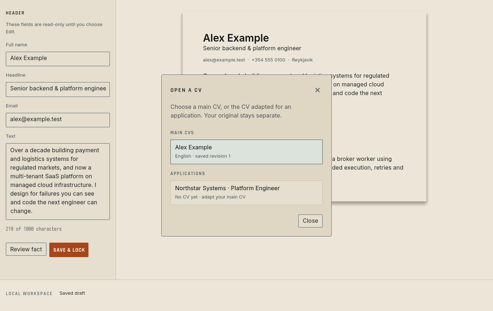

# ironmaw-egui

IRONMAW (Wormian Bones) for egui 0.36: the same design tokens as the Svelte
library, turned into an egui `Style`, the IRONMAW fonts, and a few builders for
the places where egui's defaults are too tight for long working sessions.

```rust
ironmaw_egui::install(ctx, ironmaw_egui::Edition::Oxide);

ironmaw_egui::field(ui, "Full name", |ui| ui.add(ironmaw_egui::text_field(&mut name)));
ironmaw_egui::field(ui, "Text", |ui| ui.add(ironmaw_egui::text_area(&mut passage)));
ui.label(ironmaw_egui::text::prose(&summary));
if ui.add(ironmaw_egui::primary_button("Save & lock", Edition::Oxide)).clicked() { /* … */ }
```

## What it fixes

Stock egui sets text fields at 4 × 2 pt margins, lines at about 1.2, labels
directly on their fields and panels at 8 pt from the window edge, which is
what made the CV workspace feel cramped. The theme sets:

| | Stock egui | IRONMAW |
|---|---|---|
| Body text | 14 pt, ~1.2 leading | 16 pt, ~1.5 (prose 18 pt at 1.65) |
| Text-field margins | 4 × 2 pt | 12 × 8 pt (`text_field`), 12 × 10 pt (`text_area`) |
| Label → field → next label | ~3 pt / ~3 pt | 8 pt / 16 pt (`field`) |
| Button padding, min height | 4 × 1 pt, 18 pt | 12 × 8 pt, 36 pt (primary 40 pt) |
| Panel margin | 8 pt | 16 × 12 pt (`panel_frame`) |
| Dialog | centred title bar | left display-face title, 24 pt padding (`dialog_frame`, `dialog_header`, `choice_row`) |





`cargo run --example gallery` shows the screen; `IRONMAW_STOCK=1` renders the
same screen with stock egui, `IRONMAW_EDITION=bone` the paper edition,
`IRONMAW_DIALOG=1` opens the dialog. The captures above were made with
`xvfb-run` on X11.

## Rules it carries

Teal is interactive and selection; rust is the one main action per view
(`primary_button`); amber marks things to review, never rust; the display face
(`text::label`) is for short uppercase labels only; names and Icelandic text stay
in Inter. Icons are drawn, never characters.

## Tokens

`src/tokens.rs` is generated by `scripts/build-egui.mjs` from
`src/lib/tokens/resolved/*.tokens.json` and runs as part of `pnpm run tokens`.
Never edit it by hand: change the DTCG sources and rebuild. Dimensions are
points (1 rem = 16 pt); type sizes in `size` are one step above the web list
sizes because the desktop app reads at 16 pt UI and 18 pt prose.

## Fonts

`fonts/` holds static subsets (Latin, Latin-1, Latin Extended-A, so Icelandic
renders correctly) built from `assets/fonts-src`: Inter 4 (Regular, Medium,
SemiBold instances of the variable font), Rajdhani SemiBold/Bold, Iosevka
Regular. All three families are licensed under the SIL Open Font License 1.1
(`fonts/OFL-Rajdhani.txt`; Inter © The Inter Project Authors; Iosevka © Renzhi
Li). egui's bundled fonts stay registered as fallbacks for symbols.

## Not claimed

Checked on X11 under Xvfb at 1360 × 860 only. Wayland, fractional scaling, IME
composition and screen readers were not exercised. No chamfered corners: egui
frames have no clip path, so the primary button is a plain rust rectangle.
